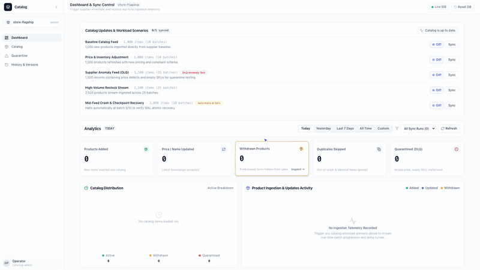
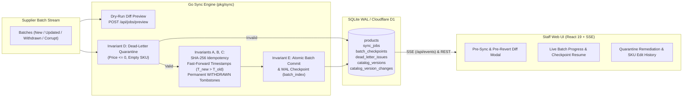

# Resilient Supplier Catalog Synchronization Engine

[](https://supplier-catalog-frontend.pages.dev)
[](https://supplier-catalog-api.pages.dev/swagger/index.html)
[](https://go.dev/)
[](https://github.com/png261/supplier-catalog/actions/workflows/ci-cd.yml)
[](scripts/check-coverage.sh)
[](Dockerfile)

A fault-tolerant supplier catalog synchronization engine built in **pure Go (`CGO_ENABLED=0`)** with embedded **SQLite WAL** storage and an embedded **React 19 + Tailwind CSS** staff dashboard. It ingests batched supplier updates with deterministic idempotency, monotonic timestamp resolution, permanent `WITHDRAWN` tombstone protection, dead-letter quarantine remediation, and atomic batch checkpoint recovery.

---

## Live Links, API Docs & Video Demo

| Resource | Cloud Production URL | Local / Repository Path |
|---|---|---|
| **Frontend Web Dashboard** | **[https://supplier-catalog-frontend.pages.dev](https://supplier-catalog-frontend.pages.dev)** | **[http://localhost:8080](http://localhost:8080)** |
| **Multi-Tenant Direct Link** | **[https://supplier-catalog-frontend.pages.dev/?shop=store-flagship](https://supplier-catalog-frontend.pages.dev/?shop=store-flagship)** | **[http://localhost:8080/?shop=store-flagship](http://localhost:8080/?shop=store-flagship)** |
| **Backend REST API** | **[https://supplier-catalog-api.pages.dev](https://supplier-catalog-api.pages.dev)** | **[http://localhost:8080/api/jobs](http://localhost:8080/api/jobs)** |
| **API Docs (Swagger UI)** | **[https://supplier-catalog-api.pages.dev/swagger/index.html](https://supplier-catalog-api.pages.dev/swagger/index.html)** | **[http://localhost:8080/swagger/index.html](http://localhost:8080/swagger/index.html)** |
| **OpenAPI 2.0 Spec (JSON)** | **[https://supplier-catalog-api.pages.dev/swagger/doc.json](https://supplier-catalog-api.pages.dev/swagger/doc.json)** | **[http://localhost:8080/swagger/doc.json](http://localhost:8080/swagger/doc.json)** |
| **Full HD Video Demo (1080p)** | **[https://supplier-catalog-frontend.pages.dev/demo_walkthrough.mp4](https://supplier-catalog-frontend.pages.dev/demo_walkthrough.mp4)** | **[`docs/demo/demo_walkthrough.mp4`](./docs/demo/demo_walkthrough.mp4)** *(1080p live interaction + OpenMOSS/MOSS-TTS voiceover & BGM)* |

### Video Walkthrough (`docs/demo/demo_walkthrough.mp4`)

[](https://supplier-catalog-frontend.pages.dev/demo_walkthrough.mp4)

<video src="./docs/demo/demo_walkthrough.mp4" controls width="100%"></video>

> **Direct Video Links (1080p + Voiceover & BGM)**: **[Watch on Cloudflare Pages](https://supplier-catalog-frontend.pages.dev/demo_walkthrough.mp4)** · **[Open Local File (`docs/demo/demo_walkthrough.mp4`)](./docs/demo/demo_walkthrough.mp4)**

---

## System Architecture



### Core Synchronization Invariants
- **Invariant A (Idempotency)**: Re-importing identical records or batches produces zero duplicates (`SHA-256` content hash check; counted as `Skipped`).
- **Invariant B (Fast-Forward Timestamps)**: Out-of-order records with $T_{new} \le T_{old}$ never overwrite newer catalog data.
- **Invariant C (Permanent Tombstones)**: Once a product is `WITHDRAWN`, it is permanently locked and cannot be reactivated by any update or rollback.
- **Invariant D (Non-Halting Quarantine)**: Malformed items (negative/zero price, empty SKU) are isolated in `dead_letter_issues` for staff remediation while valid sibling records commit normally.
- **Invariant E (Atomic Batch Checkpoints)**: Each batch commits atomically in SQLite WAL. Interrupted jobs remain `INTERRUPTED` (never falsely reported complete) and resume strictly from `committed_batch_index + 1`.

---

## Quickstart

### 1. Run with Docker Compose (Recommended Container Setup)
```bash
make docker-up
# Or directly:
mkdir -p data && chmod 777 data
docker compose up -d --build
```
- **Web UI**: [http://localhost:8080](http://localhost:8080)
- **Swagger Docs**: [http://localhost:8080/swagger/index.html](http://localhost:8080/swagger/index.html)
- **Stop Container**: `make docker-down`

### 2. Run Natively with Go
```bash
make run-server
# Or: go run ./cmd/server -port 8080 -db ./catalog.db
```

### 3. Run Sample Fixtures & Tests
```bash
# Ingest 4 sample fixture batches (mock_data/) demonstrating Invariants A-E
make ingest-demo

# Run unit & integration tests with Go race detector
make test

# Run 5-iteration race stress test & >= 90% coverage gate
make test-race
make coverage

# Run Cloudflare Worker tests (18/18) & Playwright E2E suite
make cf-test
make test-playwright
```

---

## Documentation Modules (`docs/`)

Detailed architecture diagrams, API specifications, and Assessment 1 notes are organized in the [`docs/`](./docs/README.md) directory:

- **[`docs/README.md`](./docs/README.md)** — Documentation index & high-level system map
- **[`docs/demo/demo_walkthrough.mp4`](./docs/demo/demo_walkthrough.mp4)** — Full HD 1080p live interactive walkthrough video with OpenMOSS/MOSS-TTS narration and background music
- **[`docs/architecture-and-invariants.md`](./docs/architecture-and-invariants.md)** — Detailed Mermaid flowcharts, state machines, ER diagram, and mathematical invariants (A–E)
- **[`docs/deployment-and-local-setup.md`](./docs/deployment-and-local-setup.md)** — Docker Compose, Native Go, CLI Generator, `curl` walkthrough, and CI/CD pipeline
- **[`docs/api-and-dashboard-features.md`](./docs/api-and-dashboard-features.md)** — Sequence diagrams for Pre-Sync/Pre-Revert Diff Preview, Quarantine Remediation, Product History, and full REST/SSE API table
- **[`docs/assessment-notes.md`](./docs/assessment-notes.md)** — Complete **Assumptions & Trade-offs**, **Unfinished Work & Production Roadmap**, and **AI Tools Disclosure**

---

## Assessment 1 Summary

- **Assumptions & Trade-offs**: Uses embedded SQLite in WAL mode (`_txlock=immediate`, single writer per shop tenant) for zero-dependency ACID durability; scopes transactions per batch ($T_{B_i}$) to balance throughput with instant checkpoint resumption; uses deterministic PRNG seeds (`42, 101, 999, 777, 555`) for reproducible dry-run diff previews and independent update rollbacks. *(Full details in [`docs/assessment-notes.md`](./docs/assessment-notes.md#1-assumptions--architectural-trade-offs))*
- **Unfinished Work**: Core single-store synchronization, diff preview, quarantine remediation, per-product history, and checkpoint recovery are 100% complete. Next steps for enterprise scale include OAuth2/JWT RBAC on write endpoints, S3/R2 cold batch archival, Prometheus `/metrics` + OpenTelemetry tracing, and Litestream WAL replication. *(Full details in [`docs/assessment-notes.md`](./docs/assessment-notes.md#2-unfinished-work--production-roadmap))*
- **AI Tools Disclosure**: Developed using AI-assisted pair programming (Google Antigravity / Gemini / Claude) for Go/React scaffolding, adversarial test generation, OpenAPI docs, and Playwright demo automation. All code was verified via `CGO_ENABLED=0` compilation, `go test -race -count=5`, and $\ge 90\%$ coverage gates. *(Full details in [`docs/assessment-notes.md`](./docs/assessment-notes.md#3-transparent-ai-tool-disclosure))*
