# Documentation Index — Supplier Catalog Synchronization Engine

Welcome to the technical documentation for the **Supplier Catalog Synchronization Engine**. This directory organizes the system architecture, mathematical invariants, execution guides, API reference, and Assessment 1 design notes into focused modules.

## Quick Navigation

| Document | Description |
|---|---|
| **[Root `README.md`](../README.md)** | Minimalist project overview, live links, quickstart, and documentation map |
| **[`demo/demo_walkthrough.mp4`](./demo/demo_walkthrough.mp4)** | Full HD (1920x1080) live browser walkthrough video with OpenMOSS/MOSS-TTS narration & BGM |
| **[`architecture-and-invariants.md`](./architecture-and-invariants.md)** | System architecture, database ER diagram, product lifecycle state machine, and the 5 Core Invariants (A–E) |
| **[`deployment-and-local-setup.md`](./deployment-and-local-setup.md)** | Native Go, Docker Compose container, CLI generator, sample fixtures walkthrough, and CI/CD pipeline |
| **[`api-and-dashboard-features.md`](./api-and-dashboard-features.md)** | REST API & SSE reference, Pre-Sync/Pre-Revert Diff Preview flows, Quarantine Remediation, and Product History |
| **[`assessment-notes.md`](./assessment-notes.md)** | Detailed Assumptions & Trade-offs, Unfinished Work & Production Roadmap, and AI Tools Disclosure |
| **[`swagger.json`](./swagger.json) / [`swagger.yaml`](./swagger.yaml)** | OpenAPI 2.0 / Swagger specification served at `/swagger/index.html` and `/docs` |

---

## High-Level System Overview

```mermaid
flowchart LR
    subgraph Supplier["Supplier Data Feeds"]
        B1["Batched Updates (New / Changed / Withdrawn)"]
        B2["Anomalies (Duplicates / Out-of-Order / Invalid)"]
    end

    subgraph Engine["Catalog Sync Engine (Go / Worker)"]
        P["Dry-Run Diff Preview (/api/jobs/preview)"]
        V["Invariant D: Schema & Price Validation"]
        I["Invariants A, B, C: Idempotency, Timestamps & Tombstones"]
        T["Invariant E: Atomic Batch Commit & WAL Checkpoint"]
    end

    subgraph Storage["Isolated Tenant Storage (SQLite WAL / D1)"]
        DB[("products\nsync_jobs\nbatch_checkpoints\ndead_letter_issues\ncatalog_versions\ncatalog_version_changes")]
    end

    subgraph StaffUI["Staff Web Dashboard (React 19 + SSE)"]
        UI1["Live Batch Progress & KPI Drilldowns"]
        UI2["Row-by-Row Diff Preview (Sync & Revert)"]
        UI3["Quarantine Remediation & Product History"]
    end

    Supplier --> P
    Supplier --> V
    V -- "Valid Record" --> I
    V -- "Invalid Record" --> DB
    I --> T
    T --> DB
    DB -- "SSE (/api/events) & REST" --> StaffUI
```

