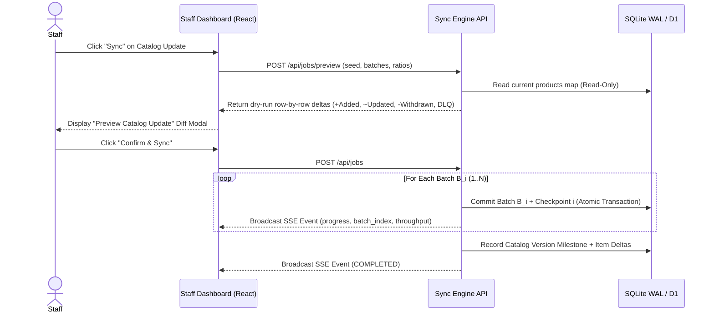
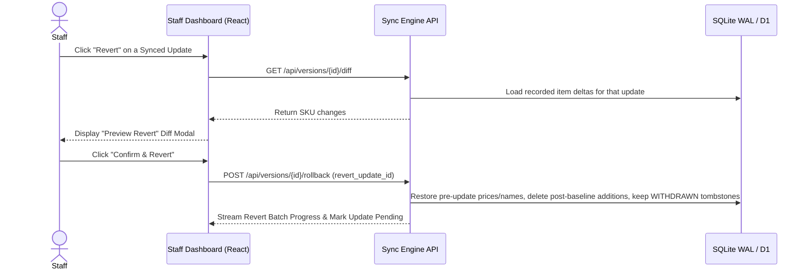
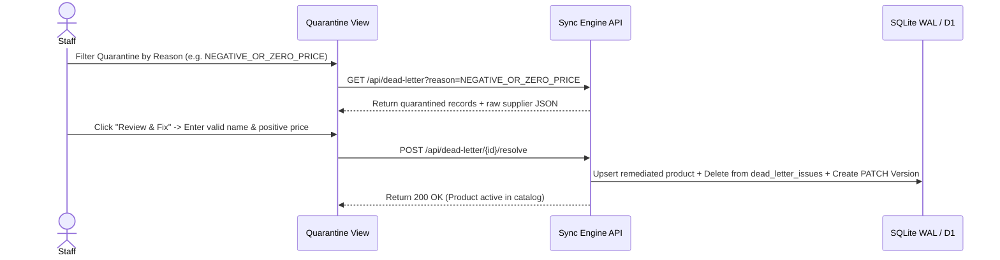

# REST API Reference & Dashboard Workflows

This document covers the interactive staff dashboard workflows and the complete REST API & Server-Sent Events (SSE) specification.

---

## 1. Interactive Workflows (Sequence Diagrams)

### A. Pre-Sync Dry-Run Diff Preview & Live Batch Execution

Before any supplier update mutates the database, clicking **Sync** runs an in-memory dry-run simulation against the current catalog and displays the row-by-row `Before -> After` diff modal.

### B. Independent Single-Update Revert with Diff Preview & Live Progress

Each synced update can be reverted independently without undoing other updates or resurrecting `WITHDRAWN` tombstones.

### C. Quarantine (DLQ) Inspection & Staff Remediation

---

## 2. REST API & SSE Endpoints

Interactive Swagger UI documentation is available at:
- **Cloud**: [https://supplier-catalog-api.pages.dev/swagger/index.html](https://supplier-catalog-api.pages.dev/swagger/index.html) (or `/docs`)
- **Local / Docker**: [http://localhost:8080/swagger/index.html](http://localhost:8080/swagger/index.html) (or `/docs`)

| Method | Endpoint | Description |
|---|---|---|
| `POST` | `/api/jobs` | Start a new synchronization job (`generator` or `batches` mode) |
| `POST` | `/api/jobs/preview` | Dry-run simulation returning row-by-row `Before -> After` diffs before syncing |
| `POST` | `/api/jobs/{id}/resume` | Resume an `INTERRUPTED` job strictly from `committed_batch_index + 1` |
| `POST` | `/api/jobs/{id}/cancel` | Halt an active job at the current batch checkpoint boundary |
| `GET` | `/api/jobs` | List synchronization jobs with status and summary counts |
| `GET` | `/api/jobs/{id}` | Retrieve job status, summary, and committed batch checkpoints |
| `GET` | `/api/products` | Query catalog products with SKU/name search and status filters (`ACTIVE`, `WITHDRAWN`) |
| `GET` | `/api/products/{sku}/history` | Retrieve chronological modification history (`Before -> After` audit trail) for a SKU |
| `GET` | `/api/dead-letter` | List quarantined supplier records with filtering by `reason` and `job_id` |
| `POST` | `/api/dead-letter/{id}/resolve` | Remediate a quarantined record and import it into the live catalog |
| `GET` | `/api/versions` | List immutable catalog version milestones (`SYNC`, `PATCH`, `ROLLBACK`) |
| `GET` | `/api/versions/{id}/diff` | Retrieve row-by-row `Before -> After` SKU changes for a version |
| `POST` | `/api/versions/{id}/rollback` | Revert a specific catalog update (`revert_update_id`) or rollback to a version |
| `GET` | `/api/metrics` | Query aggregated KPIs, catalog distribution, and time-series sync activity |
| `POST` | `/api/database/reset` | Reset the active tenant's database to a clean initial state |
| `GET` | `/api/events` | Server-Sent Events (SSE) stream for real-time batch progress and alerts |
