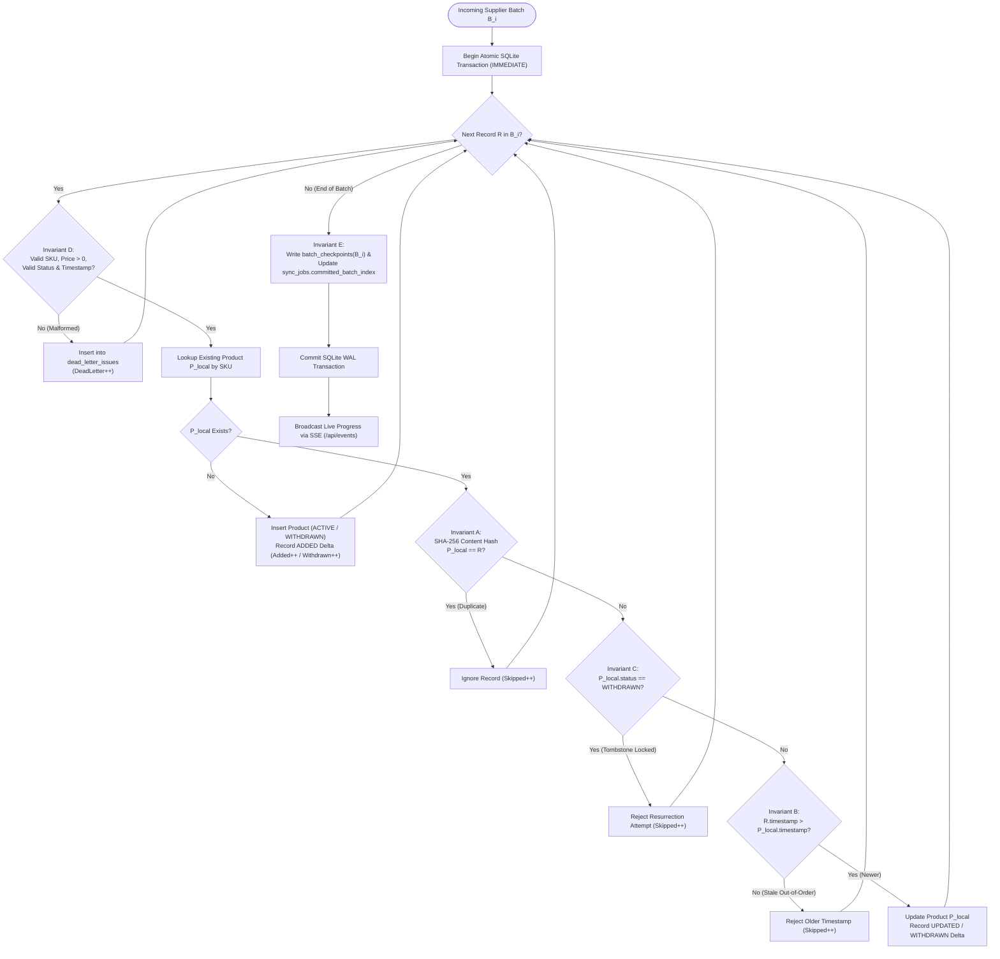
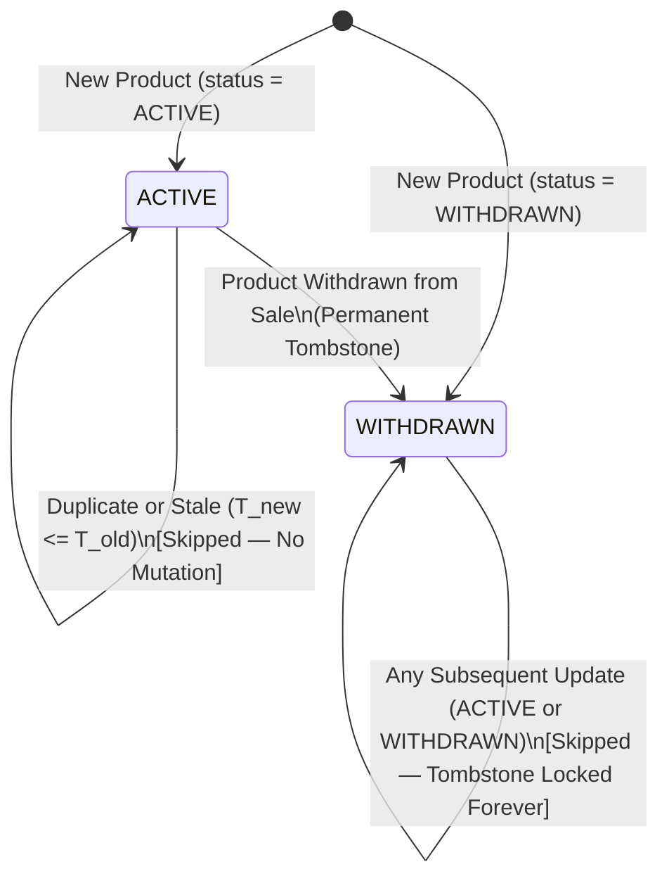
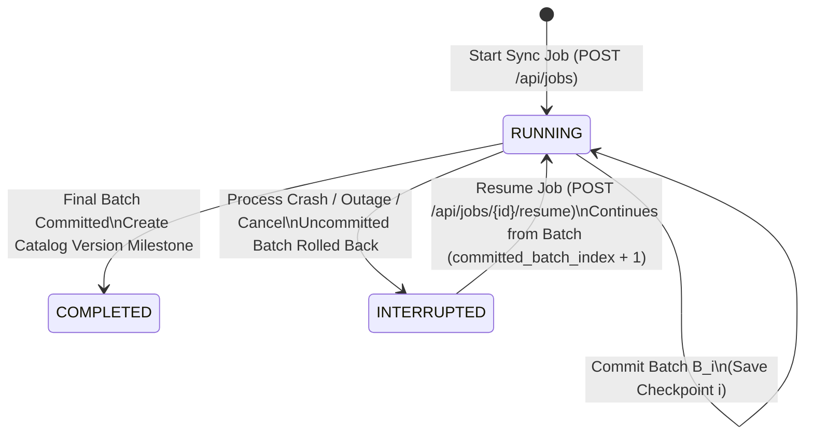
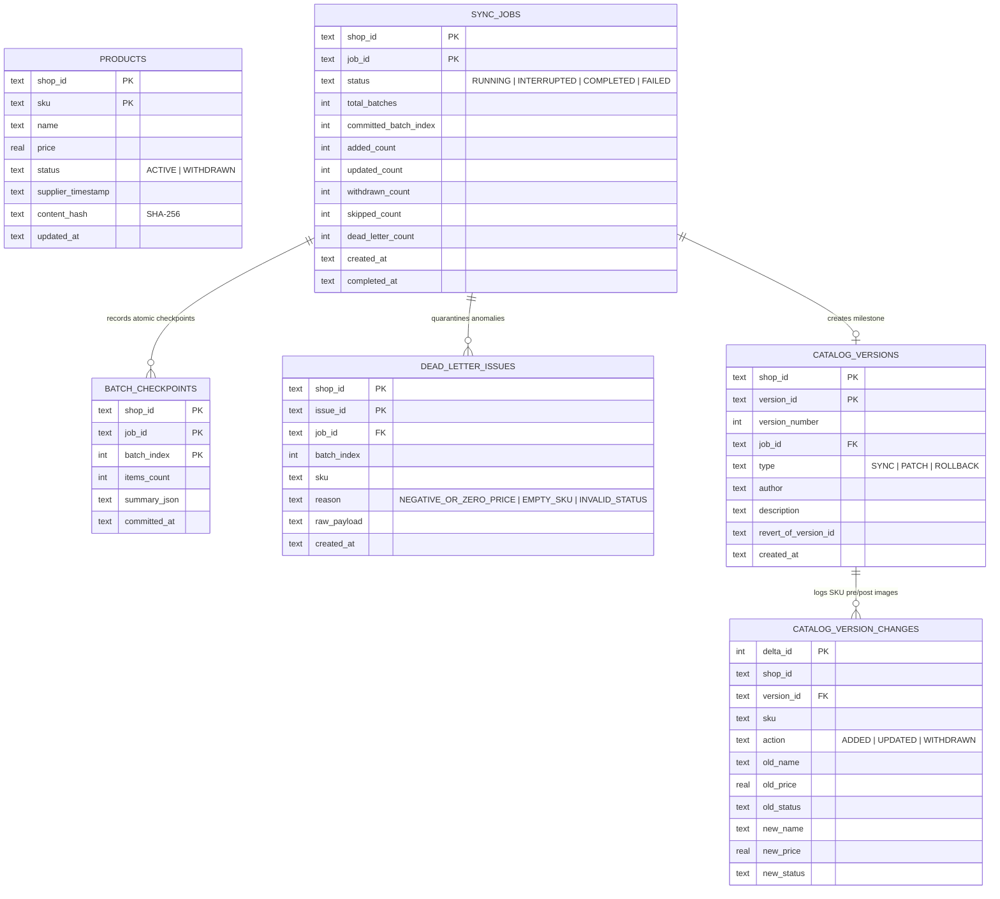

# System Architecture & The 5 Core Invariants

This document details the internal architecture, data model, state transitions, and formal synchronization invariants of the **Supplier Catalog Synchronization Engine**.

---

## 1. End-to-End Batch Ingestion Pipeline

Each incoming supplier batch executes inside an isolated transaction boundary, validating records, enforcing monotonic lifecycle rules, recording `Before -> After` item deltas, and persisting checkpoints atomically.

---

## 2. Product Lifecycle & Tombstone State Machine

Once a product transitions to `WITHDRAWN`, it becomes a permanent tombstone and can **never** be resurrected by older or newer supplier batches.

---

## 3. Sync Job Lifecycle & Crash Recovery State Machine

---

## 4. Relational Database Schema (ER Diagram)

---

## 5. Mathematical Specification of the 5 Core Invariants

### Invariant A: Deterministic Idempotency
- **Rule**: Re-ingesting an identical record payload produces zero catalog mutations and zero drift:
  $$\forall R \in \text{Batch}, \quad P_{local} \equiv R \implies \Delta(\text{Catalog}) = \emptyset, \quad \text{Skipped} \gets \text{Skipped} + 1$$

### Invariant B: Fast-Forward Timestamps (Temporal Monotonicity)
- **Rule**: Incoming records with timestamps older than or equal to the local product's `supplier_timestamp` are rejected:
  $$R.\text{Timestamp} \le P_{local}.\text{SupplierTimestamp} \implies \text{Reject}, \quad \text{Skipped} \gets \text{Skipped} + 1$$

### Invariant C: Tombstone Preservation (Monotonic Status)
- **Rule**: Once a product is marked `WITHDRAWN`, it can never be restored to `ACTIVE` by any future update or rollback:
  $$P_{local}.\text{Status} = \text{WITHDRAWN} \implies \forall R, \quad P_{local}.\text{Status} \gets \text{WITHDRAWN}$$

### Invariant D: Dead-Letter Isolation (Non-Halting Quarantine)
- **Rule**: Records with empty/whitespace SKUs, negative/zero prices, invalid status enums, or missing timestamps are isolated in `dead_letter_issues` without aborting valid sibling records in the same batch.

### Invariant E: Atomic Batch Transactions & Checkpoint Resumability
- **Rule**: Every batch $B_i$ commits product upserts, item deltas, dead-letter records, and `batch_checkpoints(i)` in a single ACID transaction. Resuming an interrupted job starts strictly at `committed_batch_index + 1`.
