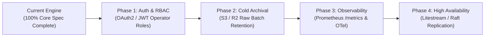

# Assessment 1: Assumptions, Unfinished Work & AI Tool Disclosure

This document provides the detailed explanations required by **Assessment 1: Supplier Catalog Updates**.

---

## 1. Assumptions & Architectural Trade-offs

1. **Single-Writer Concurrency via SQLite WAL Mode**:
   - *Decision*: Configured SQLite in Write-Ahead Logging mode (`journal_mode=WAL`) with immediate transactions (`_txlock=immediate`) and serialized writes per store tenant (`db.SetMaxOpenConns(1)`).
   - *Rationale*: Catalog ingestion is sequential per store. Using SQLite WAL eliminates `SQLITE_BUSY` deadlocks while allowing non-blocking concurrent reads for dashboard queries and SSE streams without requiring an external PostgreSQL/MySQL cluster.
   - *Trade-off*: Write throughput is bounded by single-node disk I/O (~3,000–5,000 items/sec), which comfortably exceeds single-store retail catalog needs.

2. **Batch-Level Transaction Boundaries ($T_{B_i}$)**:
   - *Decision*: Atomic transactions are scoped per batch rather than per individual item or per entire multi-batch job.
   - *Rationale*: Per-item transactions incur excessive fsync overhead, while whole-job transactions risk memory exhaustion and lose all progress upon interruption. Batch-level transactions balance high throughput with instant checkpoint resumability.
   - *Trade-off*: If a crash occurs mid-batch, the uncommitted batch rolls back cleanly and resumes from the start of that batch index.

3. **Permanent Tombstone Lock on `WITHDRAWN` Products**:
   - *Decision*: Once a product is marked `WITHDRAWN`, neither subsequent supplier updates nor catalog rollbacks can flip its status back to `ACTIVE`.
   - *Rationale*: Directly enforces the specification requirement that *"older information must not replace newer information or restore a withdrawn product"*.

4. **Deterministic PRNG Reservoir for Fictional Supplier Workloads**:
   - *Decision*: Built a deterministic PRNG batch generator (`pkg/generator`) using distinct SKU namespaces per workload scenario (`seed=42, 101, 999, 777, 555`).
   - *Rationale*: Enables reproducible dry-run diff previews (`POST /api/jobs/preview`), independent single-update syncing and reverting, and realistic anomaly injection without needing a live supplier account.

---

## 2. Unfinished Work & Production Roadmap

1. **Authentication & Role-Based Access Control (RBAC)**:
   - Add OAuth2/OIDC and JWT middleware protecting write endpoints (`POST /api/jobs`, `POST /api/dead-letter/{id}/resolve`, `POST /api/versions/{id}/rollback`), distinguishing read-only staff viewers from catalog operators.
2. **Cold Storage Batch Archival (S3 / Cloudflare R2)**:
   - Archive raw incoming supplier JSON batches to object storage with 90-day retention for compliance auditing and historical replay.
3. **Prometheus Metrics & OpenTelemetry Tracing**:
   - Expose `/metrics` for Prometheus scraping (batch latency histograms, dead-letter rates) and propagate OpenTelemetry trace spans across batch ingestion workers.
4. **Active-Passive Replication (Litestream / Raft)**:
   - Stream SQLite WAL segments continuously to S3/R2 via Litestream for sub-second disaster recovery across nodes.

---

## 3. Transparent AI Tool Disclosure

In compliance with Assessment 1 guidelines, this project was built using **100% Google Antigravity** following a disciplined **Test-Driven Development (TDD)** workflow:

1. **TDD-First Invariant Specification & Test Suites**:
   - Before implementing the core synchronization logic, all fundamental invariants (Invariants A–E: idempotency deduplication, monotonic fast-forward timestamps, permanent `WITHDRAWN` tombstones, non-halting dead-letter quarantine, and atomic batch checkpoint recovery) were codified into failing unit tests, concurrency race tests (`go test -race -count=5`), and Playwright E2E suites.
2. **Iterative Implementation & Refinement**:
   - Google Antigravity was used to implement and incrementally refine the Go domain models (`pkg/domain`, `pkg/sync`, `pkg/storage`), SQLite WAL immediate transaction boundaries, SSE event streaming, and React 19 staff dashboard components until all test suites passed.
3. **Documentation, OpenAPI & Automation**:
   - Google Antigravity assisted in authoring OpenAPI/Swagger annotations, Mermaid architectural diagrams, and the automated Playwright demo capture pipeline.
4. **Verification & Quality Gates**:
   - Every commit was verified via `CGO_ENABLED=0` builds, strict `golangci-lint` passes, a $\ge 90\%$ statement coverage gate (achieved **93.5%**), and end-to-end parity validation across both the native Go SQLite engine and the Cloudflare edge environment.
