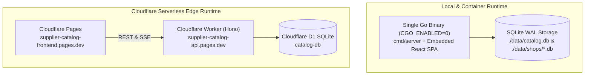
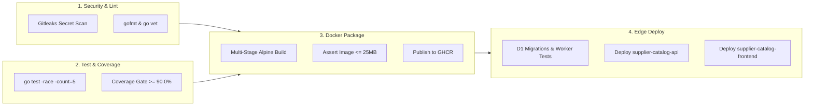

# Deployment, Container & Local Setup Guide

This guide covers running the application locally with **Native Go**, **Docker Compose**, the **CLI Mock Generator**, **Sample Fixtures**, and **Cloudflare Edge**.

---

## 1. Execution & Deployment Topology



---

## 2. Option A: Docker Compose (Recommended Turnkey Container)

Docker Compose builds the multi-stage static Alpine image ($\le 25\text{MB}$) and mounts `./data:/app/data` so the catalog and checkpoints survive container restarts.

```bash
# 1. Build frontend & start container in detached mode
make docker-up
# Or directly via Docker Compose:
mkdir -p data && chmod 777 data
docker compose up -d --build

# 2. Check container health and logs
docker compose ps
docker compose logs -f

# 3. Verify persistence across container restarts
docker compose restart

# 4. Stop container
make docker-down
```

- **Frontend UI**: [http://localhost:8080](http://localhost:8080)
- **Backend API**: [http://localhost:8080/api/jobs](http://localhost:8080/api/jobs)
- **Swagger UI Docs**: [http://localhost:8080/swagger/index.html](http://localhost:8080/swagger/index.html) (or [http://localhost:8080/docs](http://localhost:8080/docs))

---

## 3. Option B: Native Go Execution

```bash
# 1. Build frontend & Go binaries (bin/server, bin/generator)
make build

# 2. Start HTTP server on :8080
make run-server
# Or: go run ./cmd/server -port 8080 -db ./catalog.db
```

---

## 4. Option C: Running the Test Suites

```bash
# 1. Unit & integration tests with Go race detector
make test

# 2. 5-iteration concurrency race stress test
make test-race

# 3. Enforce >= 90.0% statement coverage gate & generate HTML report
make coverage

# 4. Run Cloudflare Worker & D1 test suite (18/18 tests)
make cf-test

# 5. Run Playwright End-to-End API & Chromium UI tests
make test-playwright
```

---

## 5. Step-by-Step Demo with Sample Fixtures (`mock_data/`)

With the server running on `:8080`, run all 4 fixture batches automatically:
```bash
make ingest-demo
```

Or run each batch manually via `curl`:

1. **Batch 1 — Initial Baseline (`10 Added`)**:
   ```bash
   curl -X POST http://localhost:8080/api/jobs -H "Content-Type: application/json" \
     -d '{"mode":"batches","job_id":"demo-step-1","batches":['"$(cat mock_data/batch_001_initial.json)"']}'
   ```
2. **Batch 2 — Updates, Idempotency & Withdrawals (`5 Updated, 2 Withdrawn, 3 Skipped`)**:
   ```bash
   curl -X POST http://localhost:8080/api/jobs -H "Content-Type: application/json" \
     -d '{"mode":"batches","job_id":"demo-step-2","batches":['"$(cat mock_data/batch_002_updates_and_idempotency.json)"']}'
   ```
3. **Batch 3 — Out-of-Order Timestamps & Dead-Letter Quarantine (`1 Added, 1 Updated, 2 Skipped, 3 DeadLetter`)**:
   ```bash
   curl -X POST http://localhost:8080/api/jobs -H "Content-Type: application/json" \
     -d '{"mode":"batches","job_id":"demo-step-3","batches":['"$(cat mock_data/batch_003_anomalies_and_deadletter.json)"']}'
   ```
4. **Batch 4 — Tombstone Resurrection Attempt (`1 Updated, 2 Skipped`, Withdrawn items remain `WITHDRAWN`)**:
   ```bash
   curl -X POST http://localhost:8080/api/jobs -H "Content-Type: application/json" \
     -d '{"mode":"batches","job_id":"demo-step-4","batches":['"$(cat mock_data/batch_004_tombstone_reactivation_attempt.json)"']}'
   ```

---

## 6. CI/CD Pipeline Architecture (`.github/workflows/ci-cd.yml`)


